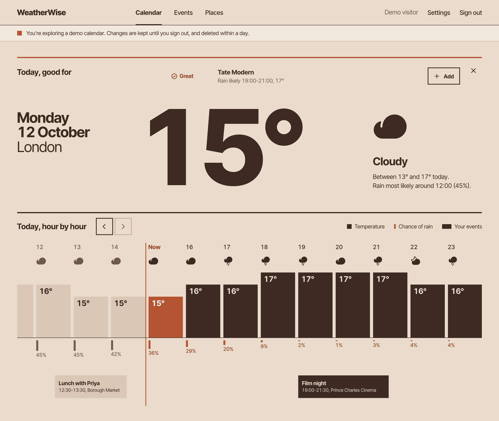
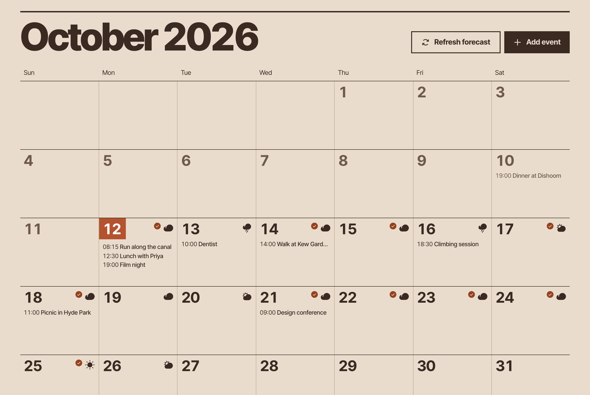
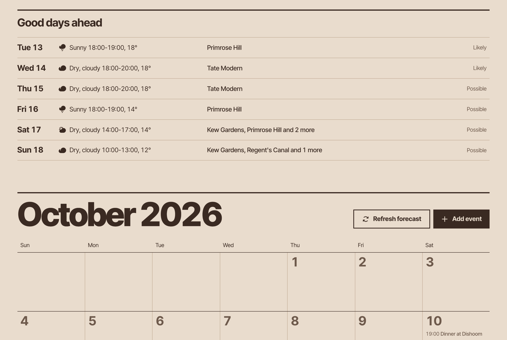
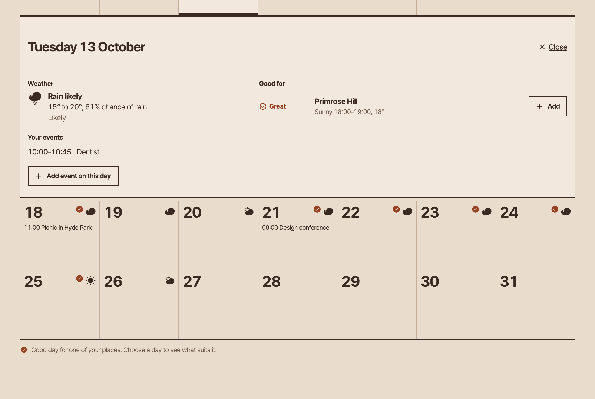
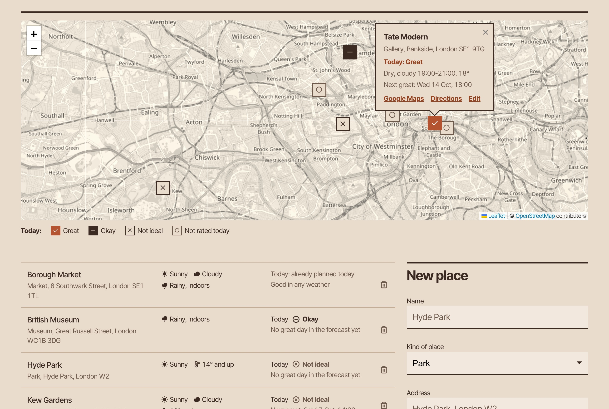
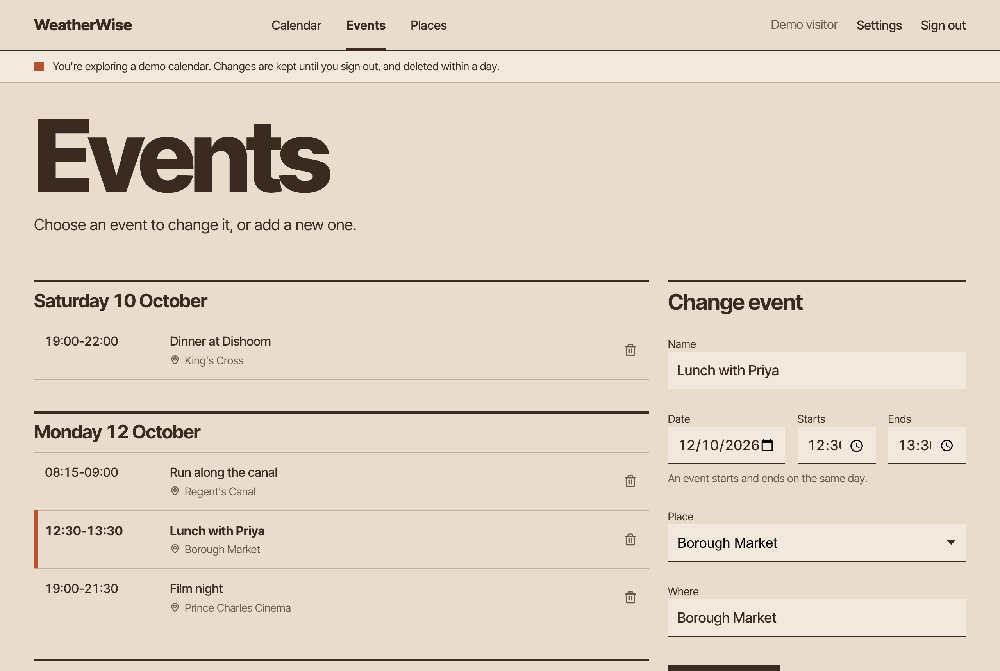
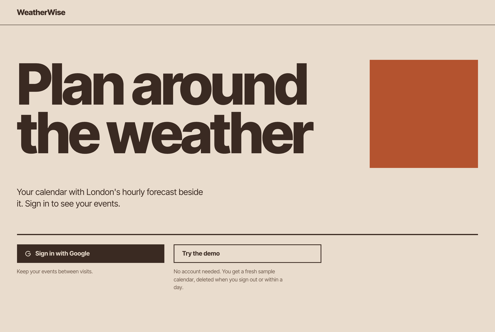
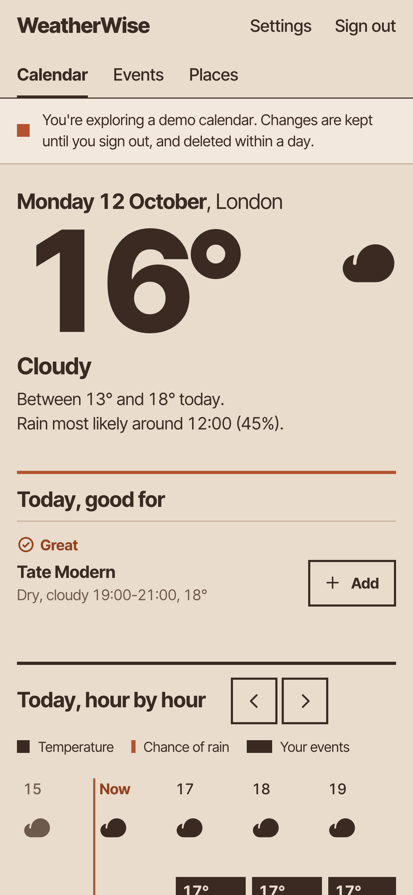
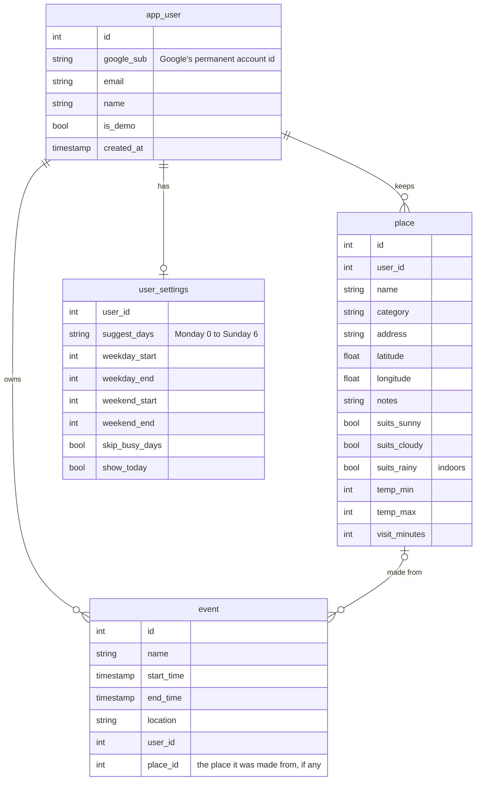

# WeatherWise Planner

> **Origin:** This project began as the [SSE TP1 Event Calendar](https://github.com/cindracindra/event-calendar-imperial-group-project), a group project for the Imperial College London MSc Software Systems Engineering, built by De Jun Tan, Cindra, Richard Lee and Timothy Ho. The group's final state is preserved at tag [`v1-group-project`](https://github.com/cindracindra/weatherwise-planner/tree/v1-group-project). All work after that tag is developed independently by Cindra.

[](https://github.com/cindracindra/weatherwise-planner/actions/workflows/ci.yml)

**Live demo:** https://weatherwise-planner.onrender.com (free hosting, so the first load after a quiet spell can take up to a minute). Use **Try the demo** to look around without an account.

## What it does

A personal calendar with London's weather beside it, so you can plan around the forecast.

- **Today at a glance:** current temperature and conditions, the day's range and when rain is most likely, with rain that sways as your cursor passes like a gust of wind.
- **Hour by hour:** today's forecast as a chart, one column per hour: temperature bars, the chance of rain, and your events laid along the same hours.
- **The month:** daily weather and UK public holidays on every day, with your events. Choose any day to open its forecast, events and suggestions.
- **Events:** add, change and delete events from one page.
- **Places:** keep the places you like (parks, museums, cafés...) with the weather each one suits and, if you like, a temperature range. Pin them on a map by address search or by clicking, and open any of them in Google Maps.
- **Suggestions:** your places are matched against the 16-day forecast, hour by hour, to find the best time for a visit: today's best fit at the top of the calendar, the good days ahead below the hours, a ✓ on good days in the month. One click turns a suggestion into an event, with Undo.
- **Settings:** which days to get suggestions for (every day, weekends, or chosen days), the hours to search on weekdays and at weekends, and whether to skip days that already have plans.
- **Accounts:** sign in with Google; each person has their own private calendar and places.

## Screenshots

**Today, hour by hour.** The current weather and the day's range, then each hour's temperature and chance of rain, with today's events along the same hours.



**The month.** Each day's forecast and events; today is marked in terracotta, and a ✓ marks days that suit one of your places.



**Good days ahead.** The coming days that suit your places, with the best time and how sure the forecast is.



**A day, opened from the month.** Its weather, your events, and the places that suit it, each with the best time and one-click Add.



**Places.** Your places on a map, each pin marked with how it suits today; a pin's card links to Google Maps and directions.



**Events.** Every event grouped by day; pick one to change it.



<table>
  <tr>
    <td width="62%"></td>
    <td width="38%"></td>
  </tr>
  <tr>
    <td><b>Sign in</b> with Google, or try a demo calendar without an account.</td>
    <td><b>On a phone</b>, the hourly chart scrolls sideways and each day in the month shows how many events it has.</td>
  </tr>
</table>

Screenshots use the demo account's sample events and places.

## How suggestions work

Each forecast day and hour is **sunny**, **dry but cloudy**, **rain likely** or **snow and storms**, from its weather code and chance of rain. A place fits it:

| Weather | The place ticks it | Otherwise |
|---|---|---|
| Sunny, dry but cloudy | ✓ Great | – Okay (any place is fine when it's dry) |
| Rain likely | ✓ Great: a rainy-day pick, since ticking rainy means indoors | ✕ Not ideal |
| Snow or storms | – Okay if indoors | ✕ Not ideal |

- A temperature outside the place's range, or strong wind at an outdoor place, lowers the fit a step, and the suggestion says why. Outdoor places don't fit after dark.
- A place that suits any weather is Okay every day: it's put forward only when nothing fits better, so it never makes every day look good.
- For each place the best time for a visit of its usual length is searched hour by hour inside your hours (by default weekdays 18:00-21:00 and weekends 09:00-18:00), avoiding the wettest hours.
- Today only suggests what can still start; a place already planned that day isn't suggested again.
- Each day says how far the forecast can be trusted: **Likely** (the next 3 days), **Possible** (up to a week), **Early look** (beyond).
- Fits are always an icon and a word as well as a colour, so they don't depend on telling colours apart.

The weather is London's, from one point in the centre, wherever a place is.

## How it's built

- **Flask** (Python), server-rendered with Jinja templates, plus a small JSON API
- **PostgreSQL** (Neon) through SQLAlchemy
- **Open-Meteo** for weather (with **MET Norway** as an automatic backup) and **Nager.Date** for public holidays
- **Leaflet** with **OpenStreetMap** tiles for the places map, and OpenStreetMap's **Nominatim** for address search (no API keys)
- **Sign-in:** Google OpenID Connect via Authlib, sessions via Flask-Login, CSRF protection via Flask-WTF
- Hosted on **Render**; CI on **GitHub Actions** (flake8 and pytest on every push and pull request)

```
Browser ──▶ Flask app ──┬─▶ web_routes (pages)     ─┐
                        ├─▶ places_routes (places) ─┤
                        ├─▶ api_routes (JSON)      ─┼─▶ database/ ──▶ PostgreSQL
                        └─▶ auth_routes (sign-in)  ─┘   services/ ──▶ Open-Meteo, Nager.Date
                                                         api/      ──▶ Nominatim
```

### Data model



One calendar per person: every event and place belongs to exactly one account, and every query is limited to the signed-in account. Someone else's event or place is reported as "not found". Deleting a place keeps the events made from it. An account without settings uses the defaults.

## Accounts and security

- **Sign in with Google** (scopes `openid email profile` only). Accounts are matched on Google's permanent id, never on email.
- **Sessions** are signed cookies (`SECRET_KEY`) holding only the user id: HttpOnly, SameSite=Lax, HTTPS-only in production, 30 days.
- **Every page and API call needs a signed-in user.** Pages redirect to sign-in; the API answers `401`.
- **CSRF tokens** on every form. The JSON API is exempt: browsers won't send JSON, PATCH or DELETE to it from another site.
- **Try the demo** creates a fresh throwaway account with sample events and places. It's deleted on sign-out or within a day, and at most 200 exist at once.
- **Errors** are logged on the server; visitors only see a plain message.

## Running it locally

1. Create a virtual environment and install dependencies:
   ```bash
   python -m venv .venv && source .venv/bin/activate
   pip install -r requirements-dev.txt
   ```
2. Create a `.env` file (never committed):
   ```
   SECRET_KEY=<output of: python -c "import secrets; print(secrets.token_hex(32))">
   GOOGLE_CLIENT_ID=<from Google Cloud Console>
   GOOGLE_CLIENT_SECRET=<from Google Cloud Console>
   PGHOST=...  PGUSER=...  PGPASSWORD=...  PGDATABASE=...  PGPORT=5432
   ```
   Google's OAuth client needs the redirect URI `http://localhost:5050/auth/google/callback` (and the production one, `https://<your-host>/auth/google/callback`).
3. Create the tables on an empty database with `database/sql_scripts/SQL_command.sql`.
4. Run with `flask run --debug --port 5050`. In debug mode the sign-in page also offers **Continue as local developer**, which never appears in production.

### Database changes

Changes to a database that's already in use go in numbered migration scripts in `database/sql_scripts/`, run in order. Each is safe to run more than once.

| Script | What it does |
|---|---|
| `001_accounts.sql` | Adds accounts (`app_user`), gives every event an owner, removes the old profile tables. Events from before accounts existed are discarded. |
| `002_places.sql` | Adds places (`place`), suggestion settings (`user_settings`) and `event.place_id`. Nothing is discarded. |

`SQL_command.sql` rebuilds everything from scratch and **deletes all data**; use it only for a new, empty database.

## API

All endpoints are under `/api`, need a signed-in session, and only ever see the signed-in account's events and places.

| Endpoint | Method | Description |
|---|---|---|
| `/api/events` | GET | Your events |
| `/api/events/<id>` | GET | One of your events |
| `/api/events` | POST | Create an event (JSON: `name`, `start_time`, `end_time`, `location`) |
| `/api/events/<id>` | PATCH | Change an event |
| `/api/events/<id>` | DELETE | Delete an event |
| `/api/places` | GET | Your places |
| `/api/places/<id>` | GET | One of your places |
| `/api/places` | POST | Create a place (JSON: `name`, `category`, and optionally `address`, `latitude`, `longitude`, `notes`, `suits_sunny`, `suits_cloudy`, `suits_rainy`, `temp_min`, `temp_max`, `visit_minutes`) |
| `/api/places/<id>` | PATCH | Change a place (only the fields sent) |
| `/api/places/<id>` | DELETE | Delete a place; events made from it are kept |
| `/api/suggestions` | GET | Every forecast day with how each of your places fits it, best first, and the best time |

Responses share one shape: `{"statusCode": 200, "statusMessage": "SUCCESS", "data": {...}}`.

## Development

```bash
flake8 .
pytest tests/
```

The tests need no database or network: database and API calls are replaced with stand-ins. More detail in [`routes/README.md`](routes/README.md) (pages, API, sign-in), [`database/README.md`](database/README.md) (schema, migrations), [`services/README.md`](services/README.md) (weather, holidays, the calendar, suggestions) and [`tests/README.md`](tests/README.md).

## Support

Please raise any issues or bugs via the [issue tracker](https://github.com/cindracindra/weatherwise-planner/issues).

## Contributing

Issues and pull requests are welcome. Please open an [issue](https://github.com/cindracindra/weatherwise-planner/issues) first to discuss larger changes, and make sure `flake8 .` and `pytest` pass before opening a pull request.

## Author

**Cindra** ([@cindracindra](https://github.com/cindracindra)), author and maintainer since the project became independent: the redesign, weather motion, accounts and Google sign-in, demo mode, and everything after tag [`v1-group-project`](https://github.com/cindracindra/weatherwise-planner/tree/v1-group-project).

**Original contributors** (the group project, up to `v1-group-project`): De Jun Tan, Cindra, Richard Lee and Timothy Ho.

## License

Released under the [MIT License](LICENSE). The original group-project code (up to tag `v1-group-project`) is copyright its four authors; later changes are copyright Cindra.

## Project status

Active
